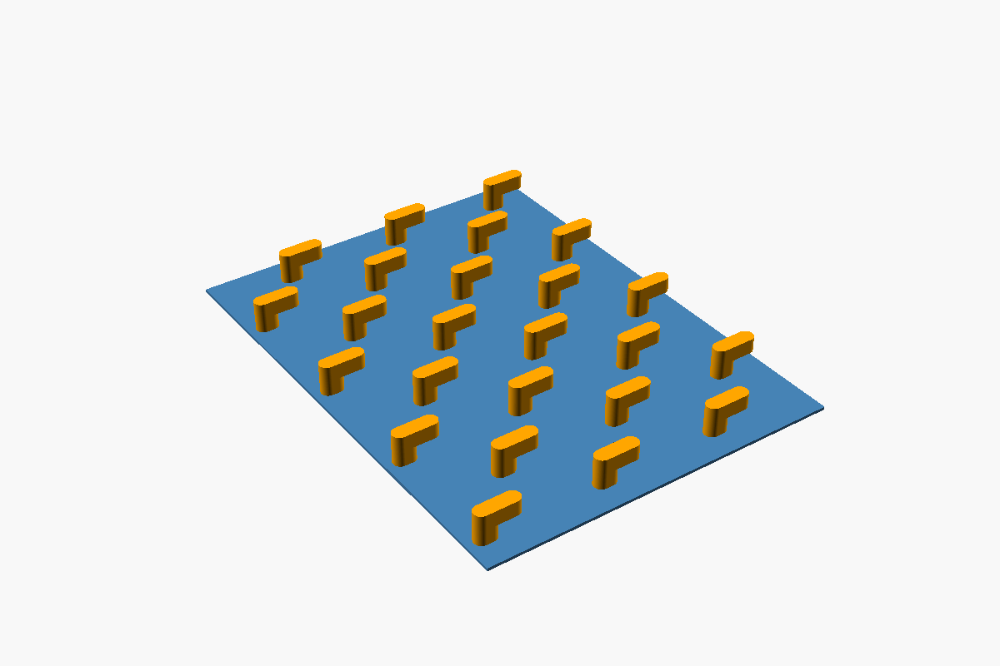
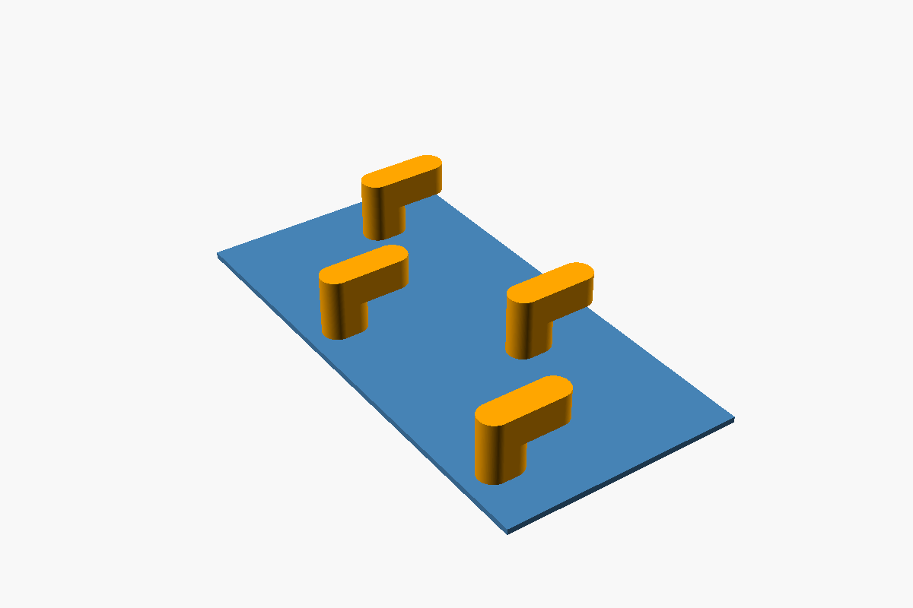
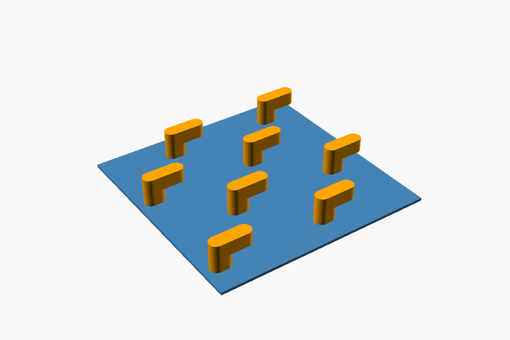
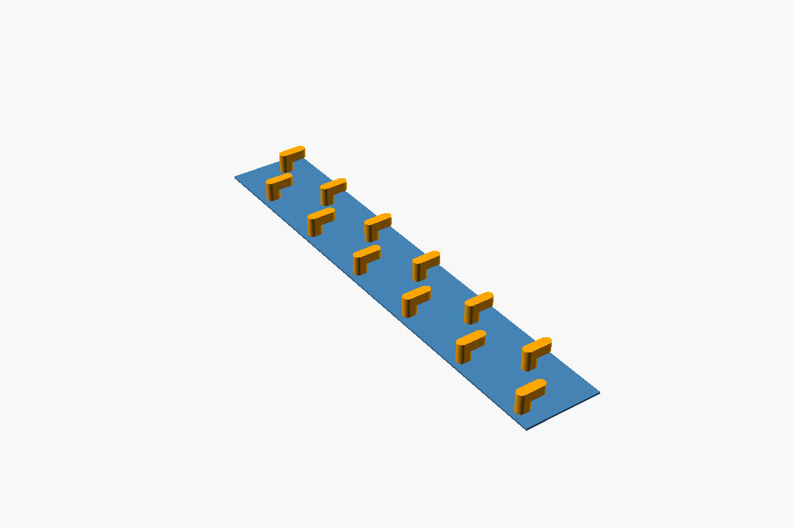
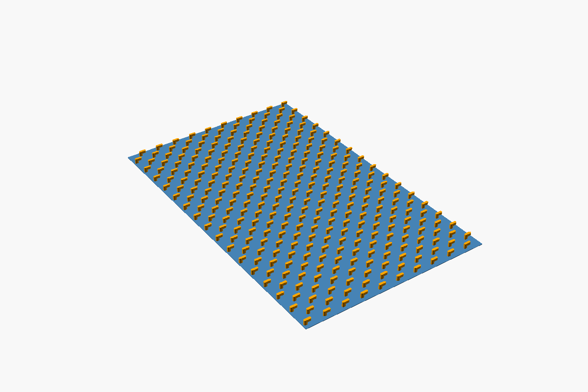
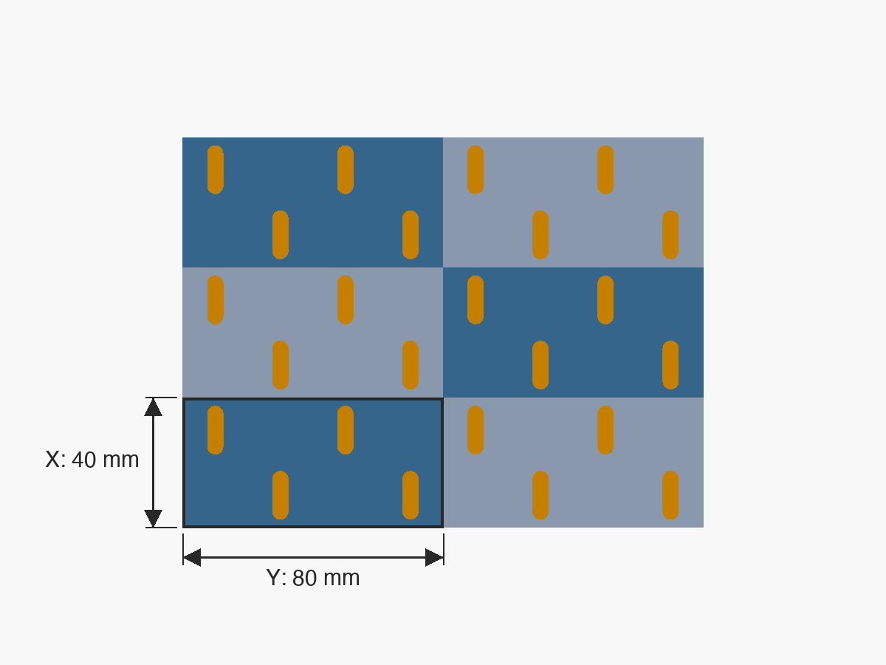

# skadis-pegs-pattern

This repository holds STEP files of backplates with pegs for the IKEA SKÅDIS pegboard. Each file holds a 1 mm backplate, its pegs and a group of locating cubes, all as separate bodies. Copies of a part tile with no gap, and each SKÅDIS slot under them gets one peg.



The peg dimensions and spacing come from [IKEA-Skadis-Pegboard-Mount-Generator](https://github.com/legna-namor/IKEA-Skadis-Pegboard-Mount-Generator) by Angel Roman.

## STEP files

| Tiles | Backplate (mm) | Pegs | STEP file by clearance | Preview |
|---|---|---|---|---|
| 1 × 1 | 40 × 80 | 4 | [0 mm](IKEA-Skadis-Peg-Tile_1x1-offset-40x80.step)<br>[0.05 mm](IKEA-Skadis-Peg-Tile_1x1-offset-40x80-clearance-0.05.step)<br>[0.1 mm](IKEA-Skadis-Peg-Tile_1x1-offset-40x80-clearance-0.1.step)<br>[0.2 mm](IKEA-Skadis-Peg-Tile_1x1-offset-40x80-clearance-0.2.step) |  |
| 2 × 1 | 80 × 80 | 8 | [0 mm](IKEA-Skadis-Peg-Tile_2x1-offset-80x80.step)<br>[0.05 mm](IKEA-Skadis-Peg-Tile_2x1-offset-80x80-clearance-0.05.step)<br>[0.1 mm](IKEA-Skadis-Peg-Tile_2x1-offset-80x80-clearance-0.1.step)<br>[0.2 mm](IKEA-Skadis-Peg-Tile_2x1-offset-80x80-clearance-0.2.step) |  |
| 1 × 3 | 40 × 240 | 12 | [0 mm](IKEA-Skadis-Peg-Tile_1x3-offset-40x240.step)<br>[0.05 mm](IKEA-Skadis-Peg-Tile_1x3-offset-40x240-clearance-0.05.step)<br>[0.1 mm](IKEA-Skadis-Peg-Tile_1x3-offset-40x240-clearance-0.1.step)<br>[0.2 mm](IKEA-Skadis-Peg-Tile_1x3-offset-40x240-clearance-0.2.step) |  |
| 3 × 2 | 120 × 160 | 24 | [0 mm](IKEA-Skadis-Peg-Tile_3x2-offset-120x160.step)<br>[0.05 mm](IKEA-Skadis-Peg-Tile_3x2-offset-120x160-clearance-0.05.step)<br>[0.1 mm](IKEA-Skadis-Peg-Tile_3x2-offset-120x160-clearance-0.1.step)<br>[0.2 mm](IKEA-Skadis-Peg-Tile_3x2-offset-120x160-clearance-0.2.step) |  |
| 10 × 8 | 400 × 640 | 320 | [0 mm](IKEA-Skadis-Peg-Tile_10x8-offset-400x640.step)<br>[0.05 mm](IKEA-Skadis-Peg-Tile_10x8-offset-400x640-clearance-0.05.step)<br>[0.1 mm](IKEA-Skadis-Peg-Tile_10x8-offset-400x640-clearance-0.1.step)<br>[0.2 mm](IKEA-Skadis-Peg-Tile_10x8-offset-400x640-clearance-0.2.step) |  |

### File names

`IKEA-Skadis-Peg-Tile_<tiles X>x<tiles Y>-offset-<offset X>x<offset Y>[-clearance-<clearance>].step`

- **tiles X**: the number of tiles along X, down the board. Each tile adds 40 mm and 2 rows of pegs.
- **tiles Y**: the number of tiles along Y, across the board. Each tile adds 80 mm and 2 pegs to each row.
- **offset X** and **offset Y**: the spacing in mm between copies when you tile the part. These values are also the size of the backplate.
- **clearance**: the clearance per side in mm. A name without this part has no clearance. Refer to [Clearance](#clearance).

For example, `IKEA-Skadis-Peg-Tile_3x2-offset-120x160-clearance-0.1.step` has 3 × 2 tiles and 24 pegs that are 4.8 mm wide. To tile it, space the copies 120 mm apart along X and 160 mm apart along Y.

### Clearance

Without clearance, each peg is 5 mm wide, the same width as a SKÅDIS slot. If the pegs are too tight in the slots, use a file with clearance. The clearance moves each side face of every peg inward by that distance. The peg positions and the backplate do not change.

| Clearance per side (mm) | Peg width (mm) | Hook length (mm) | Neck length (mm) |
|---|---|---|---|
| 0 | 5 | 15 | 7.5 |
| 0.05 | 4.9 | 14.9 | 7.4 |
| 0.1 | 4.8 | 14.8 | 7.3 |
| 0.2 | 4.6 | 14.6 | 7.1 |

The hook is the part of a peg behind the board. The neck is the part in the slot. The heights do not change: the gap between the hook and the backplate stays 5.2 mm.

### Locating cubes

Each file also holds a group named `Locating cubes`, with one cube for each peg. Use the cubes to align the part in CAD. In each row, each cube sits halfway between two slots. The cubes start at Z = 5, and their sides are the same length as the peg width.

The STEP file stores the group as a sub-assembly. Shapr3D shows the group as a folder in the Items Manager. To hide or show all of the cubes, select the visibility icon of the folder.

### Axes

All dimensions are in millimeters.

- +X points down the board. The hooks hang toward +X.
- +Y points across the board.
- +Z points away from the board. The hook tips are at Z = 0, and the backplate is from Z = 10.2 to 11.2.

## Tile a part in CAD

Use the offsets from the file name as the spacing between copies. These steps are for Shapr3D. Most CAD tools have a similar tool for linear patterns.

1. Import the STEP file with **Insert > File**.
2. Go to **Transform > Pattern**.
3. Set **Type** to **Linear**.
4. Select every body of the part: the `Backplate`, all of the `Peg` bodies and, if you use them, the locating cubes.
5. Drag the gizmo arrow that points along X.
6. Set **Spacing** to the X offset, and set **Quantity**.
7. Do steps 5 and 6 again with the Y arrow and the Y offset.
8. Select **Done**.

The copies touch edge to edge, and each SKÅDIS slot under them gets one peg.



*The outlined 1 x 1 part in a 3 x 2 pattern (3 along X, 2 along Y), seen from the peg side.*

## Make a custom peg layout

Each peg is a separate body. You can delete the pegs that you do not need.

1. Import the STEP file that covers the area that you want.
2. In the Items Manager, select the pegs to delete. To select more than one peg, hold Command.
3. Press Delete.

Do not move the remaining pegs. Each peg sits on a SKÅDIS slot.

The peg numbers follow the rows. `Peg 1` is in the row at the smallest X. In each row, the numbers increase along +Y.

## Make other sizes

You need [OpenSCAD](https://openscad.org) and [uv](https://docs.astral.sh/uv/).

```sh
uv run IKEA-Skadis-Peg-Tile-to-STEP.py --tiles 4x2 5x5 --clearance 0 0.15
```

The script writes one STEP file for each tile count at each clearance, with the file names above. Without `--tiles` or `--clearance`, it uses `tile_x`, `tile_y` and `clearance` from `IKEA-Skadis-Peg-Tile.scad`.

OpenSCAD cannot export STEP. The script builds the same shapes with [build123d](https://github.com/gumyr/build123d). Before it writes a file, it compares the shapes with the OpenSCAD render.
